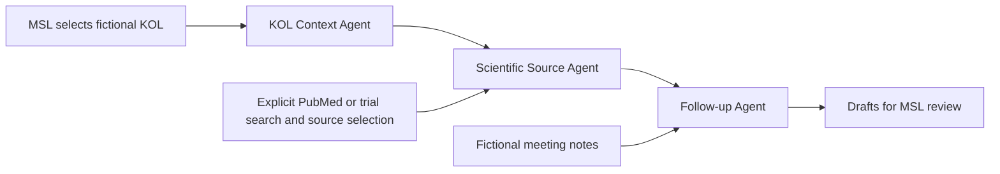

# Workshop presentation and walkthrough

Status: draft presentation script, 23 October 2026. Evaluator review and measured business outcomes remain pending. Use [the scope plan](../specs/scope-and-delivery.md) and [review pack](../specs/evaluation-and-review.md) as supporting material.

## 1. Problem

A repeat KOL meeting requires continuity: what was discussed, which scientific question remains open, and what follow-up was promised. Our hypothesis is that bringing this context together reduces preparation effort and missed commitments. This benefit has not yet been measured.

## 2. User and scenario

The MSL prepares for a repeat meeting with fictional Dr Mira Sen (KOL-DEMO-001). The fixture contains earlier interactions and an open follow-up. The KOL is an external stakeholder; the MSL retains scientific judgment and ownership of the relationship.

## 3. Architecture

LangGraph orchestrates three bounded agents. Offline mode is deterministic; explicit OpenAI mode drafts meeting priorities, source-backed briefing items and extracted follow-up requests. Model outputs require schema, source-ID and quote checks plus MSL review. Search requests use public registries; there is no autonomous external action or persistent task closure.

## 4. Live walkthrough

1. Run `streamlit run app.py` from the prototype folder.
2. Choose Offline or OpenAI LLM (configure a key locally for OpenAI); select KOL-DEMO-001; show interaction dates, the open question and prior task status.
3. Prepare without scientific sources; point out the abstention.
4. Search PubMed or ClinicalTrials.gov with a public topic, inspect identifiers, then explicitly select a record. If connectivity fails, acknowledge the error and use synthetic text from the review pack to demonstrate formatting only.
5. Enter fictional notes and prepare; show the separate CRM/source sections and draft labels.
6. Explain that scientific interpretation, ownership and due dates remain manual.
7. Change to KOL-DEMO-002; show that the old draft, notes and sources clear.

## 5. Oversight and limits

All records are fictional. Sources retain identifiers; absence of sources triggers abstention. The prototype warns against real personal information, sends no messages, updates no CRM and submits no safety cases. It has no authentication or durable audit/review trail. Explain the difference between a visible draft warning and an enforced approval mechanism.

## 6. Evidence

Show the actual pytest result and the dated live registry smoke checks in the evaluation pack. Automated checks establish tested software behavior. They do not establish medical accuracy, clinical benefit or preparation-time savings.

## 7. Evaluation and roadmap

Ask the workshop evaluator to accept or revise the scope, agent approach and manual follow-up boundary. Then run paired manual/assisted cases using an agreed rubric and source pack. Present timings and corrections only after measurement. Specialist review and production controls remain future prerequisites for any real deployment.

## 8. Requested evaluator decisions

- Accept or revise the focused repeat-meeting problem and user journey.
- Confirm whether bounded LLM agent orchestration meets workshop expectations.
- Agree submission acceptance criteria and whether task tracking is needed now.
- Record reviewer, date, feedback and required changes in the review pack.

## Live LLM demonstration prerequisite

The OpenAI integration is tested with mock responses. Configure a key in OpenAI settings on the main page and complete the [live verification checklist](../specs/llm-agents.md) before presenting real LLM behavior. Do not represent mocked test outputs as live generation.

## Presentation delivery - 24 October 2026

A [16-slide HTML deck](../presentation/index.html), [PDF](../presentation/presentation.pdf), [speaker script](../presentation/presenter-notes.md) and [portable sharing package instructions](../presentation/README.md) are now prepared. The integrated screenshot walkthrough is independent of live registry/model access. Local slides: http://localhost:8765/index.html; local app: http://localhost:8502. Source evidence remains explicit: 126 automated tests, 16 harness scenarios and eight browser checks, with no claim of reviewed live model quality or measured benefit.
